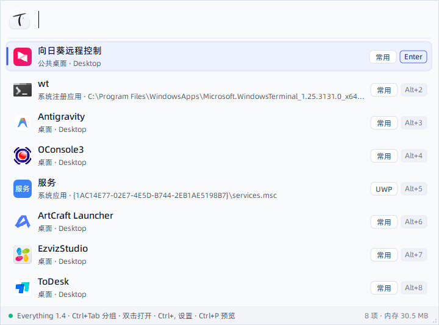
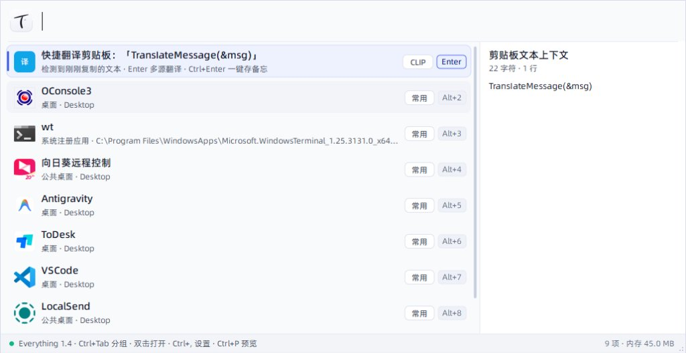

<p align="center">
  
</p>

<p align="center">
  <strong>开源、轻量、原生的桌面效率启动器与工具箱（Linux &amp; Windows）</strong>
</p>

<p align="center">
  <a href="README.md">主说明 (README)</a> · <a href="https://github.com/q871958549/Tomoyo/actions/workflows/ci.yml"></a>
  <a href="LICENSE-MIT"></a>
</p>

---

## 界面实拍

<p align="center">
  
</p>

<p align="center">
  
</p>

<p align="center">
  
</p>

---

## 核心特性

- **极速本地搜索与实时预览**：拼音 / 首字母 / 模糊匹配本地应用，直连 Windows Everything 1.4/1.5a 与 Linux `fd` + `plocate` 全盘检索；结果过多时自动展开左侧分类标签栏并支持右侧实时预览。
- **按需唤醒的一体化工具箱**：内置区域截图 / 滚动长截图 / 屏幕贴图与录屏、离线 OCR 识字、SQLite 剪贴板历史、多引擎对照翻译与本地 Markdown 备忘录。
- **极低常驻内存，闲置自动休眠**：核心启动器基于纯 Rust 原生绘制（零 Electron / 零浏览器常驻后台），窗口隐藏后自动释放缓冲并整理内存；重量面板与插件用完即焚。
- **超级面板与全局热键治理**：右键长按即可无痕划词翻译 / 处理选中文本与文件；内置热键占用扫描，一键定位冲突进程，自动避让全屏游戏与远程桌面。
- **开放的多运行时插件生态**：支持搜索框直接检索插件并快捷直达设置（如 `备忘录 设置`）；支持 Rust STDIO、Python、`wasmi` WASM 沙箱与 WebView（兼容基础 `uTools` API）。

---

## 常用按键与指令

| 快捷键 / 输入 | 说明 |
|---|---|
| `Alt+Space` / `Esc` | 呼出主窗口 · 两段式静音清屏与隐藏 |
| `Ctrl+Tab` / `Ctrl+1..9` | 切换文件分类筛选 · `@tag` 行内过滤 |
| `备忘录 设置` / `Ctrl+Enter` | 搜索已安装插件并直达对应插件设置 |
| `f <关键词>` | Everything / `fd` 全盘文件搜索 |
| `F1` / `Alt+S` / `F3` | 区域与滚动截图 · 一键桌面贴图（再按开关隐藏） |
| `Alt+T` / `fy <文本>` | 划词与多引擎对照翻译 |
| `Alt+C` / `cb` | 剪贴板历史与顺序粘贴栈 |
| `note` / `bw` | 打开本地备忘录工作台 |
| `Ctrl+,` / `:stats` | 打开设置中心 · 查看内存与插件状态 |

---

## 安装与源码构建

- **直接安装**：前往 [GitHub Releases](https://github.com/q871958549/Tomoyo/releases) 下载对应系统的安装包或压缩包（Windows 安装包 / 便携包、Linux 发行包）。
- **源码构建**：

```bash
cd frontend && npm ci && npm run build && cd ..
cargo build --release --workspace
```

> 更多开发与架构细节见 [`docs/`](docs/)（[架构说明](docs/ARCHITECTURE.md)、[插件协议](docs/PLUGIN_PROTOCOL.md)、[编码规范](docs/CODING_STANDARDS.md)）。双协议开源：**MIT / Apache-2.0**（[LICENSE-MIT](LICENSE-MIT) | [LICENSE-APACHE](LICENSE-APACHE)）。
