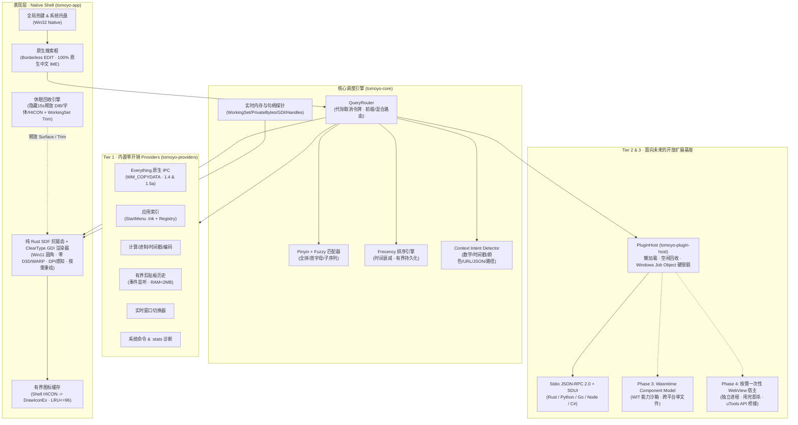

# Tomoyo — 开源 Rust 效率启动器架构蓝图与实施计划

> **愿景**：打造一款 **100% 开源、极致轻量、永不内存泄露、深度融合 Everything 等优质生态、面向未来多语言扩展** 的下一代效率启动器，从架构根基上彻底替代 Electron 架构的 uTools。

---

## 一、深度需求分析：为什么现有方案不够好？

### 1.1 uTools 的核心价值（必须保留并超越）
| 维度 | 核心体验 | Tomoyo 对标与超越策略 |
|---|---|---|
| **瞬时呼出** | 全局快捷键（`Alt+Space`）毫秒级呼出，用完即隐 | 纯原生 Win32 + Direct2D，< 1ms 呼出，零 WebView/Electron 冷启动 |
| **超级搜索** | 应用启动、拼音/首字母模糊匹配、高频学习（Frecency） | 内置全拼/首字母匹配 + 时间衰减 Frecency + 窗口切换 + 计算/换算 |
| **文件极速搜索** | 搜索本机数百万文件 | **第一公民级原生集成 Everything 1.4 / 1.5a IPC**（零外部 DLL 依赖，亚毫秒查询，直达终端/定位/复制路径/动作面板） |
| **意图识别（超级匹配）** | 粘贴/输入时间戳、颜色、表达式、路径、URL 自动匹配能力 | 内置零开销 `IntentDetector` + 插件级 Regex/剪贴板类型触发器 |
| **丰富插件生态** | 列表插件 + 富交互视图插件 + 开发者低门槛接入 | **三层渐进式扩展基座**：原生 Provider + 跨语言 JSON-RPC/SDUI + 未来 WASM/按需 WebView 兼容桥 |

### 1.2 uTools / Electron 方案的核心痛点（必须根治）
1. **常驻内存毒瘤 & 长期运行泄露**：Electron 即使静默后台仍常驻 Main + Renderer + GPU + Utility 多个进程（150MB–500MB+），连续运行数日后 V8 堆、Chromium 合成器与插件残留轻松突破 1GB。
2. **闭源商业化与账号壁垒**：核心闭源、插件市场强绑定账号/会员、数据隐私不可控。
3. **插件运行时隔离与回收缺失**：第三方插件与主界面耦合，缺乏硬内存上限与空闲自动销毁机制。
4. **对开发者语言栈的限制**：强绑定 Node/JS 生态，Rust / Python / Go / C# / Zig 开发者难以优雅编写高性能插件。

---

## 二、总体架构蓝图

### 2.1 分层系统架构

### 2.2 严禁成为资源毒瘤：反泄露与低内存工程铁律

> [!IMPORTANT]
> 低内存和零泄露不是事后调优项，而是写入代码骨架的 **硬性架构不变量（Architectural Invariants）**。
>
> **实测架构演进记录**：在 Phase 1 逐阶段内存剖析中，我们发现 `ID2D1DCRenderTarget` 会隐式拉起 `d3d10warp.dll` 软件光栅化器，永久性增加 **+51.4 MB Private Commit** 与 **+219 个内核句柄**。据此我们果断切换为 **纯 Rust SDF 抗锯齿 32-bit DIB + 原生 ClearType GDI + `DrawIconEx`** 渲染管线，将 Private Commit 骤降 **4.5 倍**（66.5 MB → **14.79 MB**），且 **100 轮完整绘制+休眠压测实现 0.00 MB 泄露、+0 GDI/USER/内核句柄漂移**！

1. **双态生命周期（Active ↔ Hibernated）**：
   - **活跃态（窗口显示）**：分配 32-bit 双缓冲 DIB 与 ClearType 字体，实测无图标绘制仅 **8.06 MB Private**、加载 Shell 图标后 **14.79 MB Private**（0 MB GPU 显存）。
   - **休眠态（隐藏超过 15 秒）**：自动释放双缓冲 DIB、GDI 字体与全部缓存 `HICON`，裁剪结果与索引缓冲，并执行安全 Working Set Trim。实测休眠态 Working Set **0.10 MB**、Private **14.79 MB**、**0% CPU（纯消息阻塞 `GetMessageW`，零轮询定时器）**。
2. **所有数据结构强制有界（Bounded Everything）**：
   - 严禁出现无界 `Vec` / `HashMap` / Channel。
   - 图标 LRU 上限 128 项（所有 `HICON` 严格 RAII `DestroyIcon`，杜绝 GDI/USER 句柄泄露）。
   - 剪贴板内存环形缓冲硬顶 100 条且单条文本截断 16KB（内存总上限 < 2MB）。
   - 每次按键分配单调递增 `generation: u64`，旧搜索任务立即丢弃。
3. **插件进程级硬隔离（Windows Job Objects）**：
   - 外部插件**开机零启动（Lazy Spawn）**，仅在关键词/上下文命中时拉起。
   - 绑定 `JOB_OBJECT_LIMIT_KILL_ON_JOB_CLOSE`（主进程退出时操作系统自动清理全部子进程，零孤儿僵尸）与 `JOB_OBJECT_LIMIT_PROCESS_MEMORY`（单插件默认硬内存天花板 128MB，失控插件直接熔断，绝不拖垮宿主机）。
   - **空闲回收器（Idle Reaper）**：插件空闲超过配置 TTL（默认 60s）自动优雅关闭并回收进程；当无活跃插件时回收线程通过 `Condvar` 深度休眠（0 CPU 唤醒）。
4. **透明可观测性（Built-in `:stats` & 自动化泄露压测）**：
   - 用户随时可在主界面输入 `:stats` 查看实时 Private Bytes、Working Set、GDI/USER/内核句柄数、运行中插件进程及其内存占用，并支持 `:gc` 手动触发休眠整理。

---

## 三、面向未来的三层插件协议设计 (`tomoyo-protocol` + `tomoyo-sdk`)

### 为什么这套扩展基座「面向未来」？
- **语言无关，零门槛添砖加瓦**：只要能读写 `stdin/stdout` JSON，**50 行 Python/JS/Go/C#** 或 **25 行 Rust (`tomoyo-sdk`)** 即可写出生产级插件。
- **声明式 UI（SDUI）优先**：90% 的插件只需要列表、分组、副标题、图标、预览面板与快捷动作，无需打包 100MB 浏览器运行时即可获得原生 120fps 界面。
- **平滑演进到 WASM & 按需 WebView**：协议层 `tomoyo-protocol` 与传输层解耦，未来无缝接入 `wasm32-wasip2` 沙箱插件，以及按需拉起、关闭即杀的独立 WebView 宿主（兼容 uTools 插件迁移）。

---

## 四、Cargo Workspace 模块规划

| Crate / 目录 | 职责 | 关键依赖与约束 |
|---|---|---|
| `crates/tomoyo-protocol` | 插件 Manifest、JSON-RPC 2.0、查询/结果/Action/SDUI 协议类型 | 纯 Rust + `serde`，零 OS 依赖，供第三方插件直接复用 |
| `crates/tomoyo-everything` | 纯 Rust Everything 1.4 / 1.5a 原生 IPC 客户端 (`WM_COPYDATA`) | 零第三方 DLL 依赖，超时防阻塞，完整解析路径/大小/修改时间 |
| `crates/tomoyo-core` | QueryRouter、Pinyin/Fuzzy 匹配、Frecency、Intent 识别、内存/句柄遥测 | 零重型异步运行时，严格有界容器 |
| `crates/tomoyo-providers` | 内置 Providers：Everything、Apps、Calc、Clipboard、Windows、System/`:stats` | 原生 Win32 API + `pinyin (plain)` |
| `crates/tomoyo-plugin-host` | 外部插件发现、懒加载、Job Object 隔离、JSON-RPC 通信、Idle Reaper | 进程级故障/内存隔离 |
| `crates/tomoyo-sdk` | 第三方 Rust 插件极简开发包 (`TomoyoPlugin` trait) | 依赖 `tomoyo-protocol` |
| `crates/tomoyo-app` | 原生 Windows 桌面启动器（Win32 + D2D + DWrite + 托盘 + 热键 + 休眠） | `windows` crate + `mimalloc` |
| `plugins/example-*` | Rust SDK 与 Python 零依赖参考插件 | 端到端验证多语言扩展生态 |

---

## 五、分阶段实施路线图

- **Phase 1 — 坚实内核与可用 MVP（已完成并实测通过 ✅）**
  - [x] Workspace 脚手架、MIT/Apache-2.0 双许可、架构与协议文档
  - [x] `tomoyo-protocol` 完整协议定义与序列化测试
  - [x] `tomoyo-everything` 原生 IPC 客户端（`WM_COPYDATA` 真实回环测试通过，支持 1.4 & 1.5a）
  - [x] `tomoyo-core` 路由引擎、拼音/模糊匹配、Frecency、IntentDetector、内存/句柄遥测
  - [x] `tomoyo-providers` 六大内置引擎（Everything / Apps / Calc / Clipboard / Windows / System & `:stats`）
  - [x] `tomoyo-plugin-host` + `tomoyo-sdk` + Rust/Python 双语言示例插件（含 Windows Job Object 硬限额与 Idle Reaper 端到端实测通过）
  - [x] `tomoyo-app` 原生 Win32 + 纯 Rust SDF 抗锯齿 + ClearType GDI 桌面客户端（`1.74 MB` 单文件 Release、100 轮压测 `+0.00 MB / +0 句柄` 零泄露）
- **Phase 2 — 体验打磨与深度效率工具（已完成并实测通过 ✅）**
  - [x] 右侧实时预览面板（`Ctrl+P`，有界 8 KB 文件/目录/代码预览、剪贴板多行预览、插件 SDUI 卡片、Everything 语法提示）
  - [x] `config.toml` 热重载（自定义全局热键、`:theme dark|light|midnight` 现代白/深空主题实时切换、Everything 过滤、自定义 Web 搜索引擎 `g`/`gh`/`crates`/`bd`/`zh`/`mdn`、Windows 登录自启 `:autostart`）
  - [x] SQLite 持久化剪贴板历史（`PRAGMA cache_size = -256` 256 KB 缓存天花板 + 休眠 `PRAGMA shrink_memory`）
  - [x] 原生 Windows OLE 文件拖拽拖出（`DoDragDrop` + `IShellFolder`，直接拖入资源管理器/VS Code/微信）
  - [x] **现代白艺术化品牌重设计**：现代白瓷感圆角图标 + 书法雕塑感黑曜石 `T` + 冰银微点（原生超采样 SDF 渲染 + PNG/SVG 品牌资产）
- **Phase 3 — WASM 能力沙箱与去中心化插件生态（已完成并实测通过 ✅）**
  - [x] `wasmi 2.0` 零 JIT 能力沙箱运行时（指令燃料防死循环 + 线性内存硬顶 + 按权限门控宿主导入 + 空闲即卸载归零）
  - [x] `tomoyo-wasm-sdk` + 真实编译的 `plugins/example-wasm/plugin.wasm`（142 KB，JWT 解码 & 存储单位换算）
  - [x] `tomoyo-cli`（`new` 四语言脚手架、`verify` 实时冒烟验证、`hash`、`registry list` & 强制 SHA-256 校验 `install`）+ `registry/index.json` 去中心化开源清单
- **Phase 4 — 按需独立 WebView 宿主与 uTools 插件兼容桥（已完成并实测通过 ✅）**
  - [x] 独立可执行文件 `tomoyo-webview-host.exe`（`1.20 MB`，平时零后台常驻，打开时按需拉起并绑定 Job Object，按 `Esc`/关闭即彻底退出释放全部 `msedgewebview2.exe`）
  - [x] 完整注入 `window.tomoyo` + **`window.utools` 兼容适配层**（`onPluginEnter`/`onPluginReady`、`setSubInput`/`removeSubInput`、`copyText`、`hideMainWindowPasteText`、`outPlugin`、`shellOpenExternal`/`Path`、持久化 `db` & `dbStorage`、`Ctrl+Shift+T` 窗口置顶）
  - [x] 离线示例插件 `plugins/example-webview-json`（`json` / `utools` 触发，交互式 JSON 格式化检视器）
- **Phase 5 — 图形化设置中心、中文体验与 v0.4.0 生态闭环（已完成并实测通过 ✅）**
  - [x] 自由拖拽窗口位置、八向边缘调宽调高、拖拽预览分割线、几何坐标持久化、主列表/Logo 原生右键菜单
  - [x] **阿里巴巴普惠体 3.0** 私有加载、简体中文主语言 + 英文双语切换、三套主题实时同步 DWM 标题栏与自定义滚动条、快捷键直按自动录入与全局修改即时自动保存
  - [x] **零膨胀 WinHTTP GitHub Releases 自动更新系统**（启动按周期静默检查 + `:update` 命令 + 托盘/Logo 右键入口 + 底部 `↑ vX.Y.Z` 徽标 + 设置中心更新日志预览与直达下载）
  - [x] **图片剪贴板历史 & PNG 缩略图预览**（`CF_DIB` 捕获 → 内容寻址 PNG 落盘 + 最大 50 张磁盘 LRU 淘汰，零像素常驻内存；`Enter` 回写 `CF_DIB` 直贴原窗口）
  - [x] **Super Match 粘贴胶囊**（输入框 `Ctrl+V` 识别图片/文件列表，直出看图/Base64/SHA-256/打开终端动作）
  - [x] **进程巡检与结束器 (`kill` / `ps`)**、**设置中心内置开放插件市场（SHA-256 校验一键安装/卸载）**、`tomoyo-cli import-utools` 一键导入与远程 HTTPS 索引支持
  - [x] **GitHub Actions CI & Release 自动化流水线**（推送到 `https://github.com/q871958549/Tomoyo` 自动跑全量单测、100 轮反泄露压测与便携版 ZIP + SHA256SUMS 发布）
- **Phase 6 — 长期演进方向**
  - Windows Winget / Scoop / MSIX 分发包与一键静默热更新替换脚本
  - 多平台 UI 适配器（`tomoyo-ui-macos` / `tomoyo-ui-linux`）与本地 OCR / 离线向量语义检索可选插件

