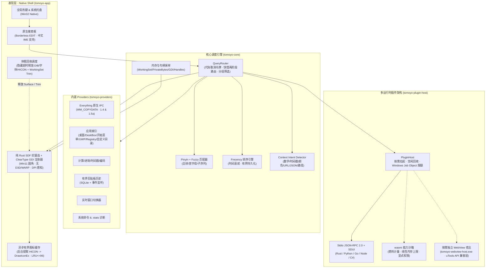
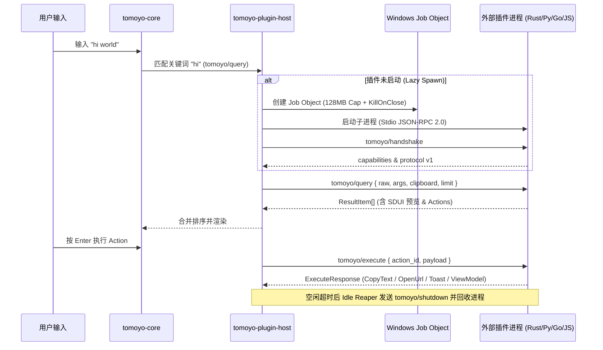

# Tomoyo 架构说明 (Architecture Overview)

> **设计目标**：使用 Rust 与原生 Win32 API 构建开源桌面启动器，支持 Everything 文件搜索与多语言插件隔离运行，同时将闲置后台资源占用保持在较低水平。

---

## 一、设计背景与解决的问题

### 1.1 核心功能对标
| 维度 | 目标能力 | Tomoyo 实现策略 |
|---|---|---|
| **窗口呼出** | 全局快捷键（`Alt+Space`）唤起与隐藏 | 原生 Win32 窗口 + 纯 Rust SDF / ClearType GDI 绘制，无 Electron/浏览器常驻冷启动开销 |
| **混合检索** | 应用启动、拼音/首字母匹配与高频排序 | 全拼/首字母匹配 + 时间衰减 Frecency + DeskBox/自定义目录扫描 + 计算与窗口切换 |
| **文件搜索** | 快速检索本地文件 | 原生 Everything 1.4 / 1.5a `WM_COPYDATA` IPC 客户端，支持分类筛选下推与动作面板 |
| **上下文匹配** | 对剪贴板/输入中的时间戳、颜色、表达式、路径作出响应 | 内置轻量 `IntentDetector` 与 `Super Match` 粘贴胶囊处理 |
| **扩展能力** | 兼顾列表型扩展与富交互面板 | 分层扩展方案：内置 Rust Provider + STDIO JSON-RPC + WASM (`wasmi`) + 按需 WebView 宿主 |

### 1.2 常见启动器开销来源
1. **常驻进程内存偏高**：Electron 类应用后台通常常驻 Main + Renderer + GPU 等多个进程。
2. **封闭商业分发**：部分软件绑定账号体系或闭源市场。
3. **插件缺乏资源上限**：插件与主界面耦合时，异常扩展容易持续占用主进程内存。
4. **语言栈受限**：只支持 Node/JS 时，Rust / Python / Go / C# 等语言开发者较难直接编写扩展。

---

## 二、系统架构

### 2.1 模块分层

### 2.2 内存控制与防泄露设计

> [!NOTE]
> 在早期性能剖析中，`ID2D1DCRenderTarget` 会隐式加载 `d3d10warp.dll` 软件光栅化器，导致 Private Commit 增加约 51.4 MB、内核句柄增加 219 个。因此渲染路径统一采用 **纯 Rust SDF 抗锯齿 32-bit DIB + 原生 ClearType GDI + `DrawIconEx`** 方案。

1. **活跃态与休眠态切换**：
   - **活跃态（窗口显示）**：按需创建 32-bit 双缓冲 DIB 与 ClearType 字体，由后台线程异步提取 Shell 图标与预览内容，避免阻塞 UI 线程。
   - **休眠态（隐藏超时）**：释放双缓冲 DIB、GDI 字体、缓存 `HICON` 与图片预览，收缩 SQLite 页缓存，裁剪结果缓冲并通知工作线程及主线程执行 `mi_collect(true)` 归还 `mimalloc` 页，保持 0% 空闲 CPU 唤醒（消息阻塞等待 `GetMessageW`）。
2. **有界数据结构**：
   - 图标 LRU 缓存上限 96 项（`HICON` 通过 `Drop` 调用 `DestroyIcon`）。
   - 剪贴板缓存上限有界且单条文本与图片均限制尺寸。
   - 每次按键分配单调递增 `generation: u64`，旧查询结果直接丢弃。
3. **插件资源隔离**：
   - 外部插件按需启动，绑定 `JOB_OBJECT_LIMIT_KILL_ON_JOB_CLOSE` 与 `JOB_OBJECT_LIMIT_PROCESS_MEMORY`（默认 128 MB 上限）。
   - 闲置超时后自动终止并清理，无活跃插件时回收线程通过 `Condvar` 挂起。
4. **运行时可观测性**：
   - 主界面输入 `:stats` 可实时查看 Private Bytes、Working Set、GDI/USER/内核句柄数量及活跃插件进程信息；`:gc` 可手动触发休眠整理。

---

## 三、插件通信模型 (`tomoyo-protocol` + `tomoyo-sdk`)

- **跨语言支持**：只需读写 `stdin/stdout` JSON 行文本即可编写插件，可用 Python/Node/Go 或 `tomoyo-sdk`（Rust）实现。
- **声明式结果（SDUI）**：列表插件通过结构化 `ResultItem` 与 `PreviewSpec` 即可呈现，无需单独启动浏览器进程。
- **沙箱与按需 WebView 补充**：纯计算插件可选 `wasm`（`tomoyo-wasm-sdk` + `wasmi`），复杂交互界面则通过短生命周期 `tomoyo-webview-host.exe` 承载并在关闭后退出。

---

## 四、Cargo Workspace 模块划分

| Crate / 目录 | 职责 | 关键依赖与约束 |
|---|---|---|
| `crates/tomoyo-protocol` | 插件 Manifest、JSON-RPC 2.0、查询/筛选/Action/SDUI 类型 | 纯 Rust + `serde`，无 OS 依赖 |
| `crates/tomoyo-everything` | Everything 1.4 / 1.5a `WM_COPYDATA` IPC 客户端 | 无第三方 DLL 依赖，带查询超时保护 |
| `crates/tomoyo-core` | 配置、QueryRouter（两阶段检索与筛选）、Pinyin/Fuzzy、Frecency、Intent、WinHTTP/更新检查、遥测 | 不引入重型异步运行时，容器有界 |
| `crates/tomoyo-providers` | 内置 Providers：Everything、Apps、Calc、Clipboard、Process、WebSearch、Windows、System | 原生 Win32 API + `pinyin` |
| `crates/tomoyo-plugin-host` | 插件发现、按需加载、Job Object 隔离、JSON-RPC、`wasmi`、Idle Reaper | 进程与沙箱隔离 |
| `crates/tomoyo-sdk` | Rust STDIO 插件开发包 (`TomoyoPlugin` trait) | 依赖 `tomoyo-protocol` |
| `crates/tomoyo-wasm-sdk` | WebAssembly 插件开发包 | 依赖 `tomoyo-protocol` |
| `crates/tomoyo-webview-host` | 按需独立 WebView2 宿主（承载设置中心、剪贴板工作台、多源翻译、OCR 审校与 `window.utools` 兼容桥） | 独立短生命周期进程（嵌入 `frontend/dist/*.html`） |
| `frontend/` | 极简现代风格工程化前端（Svelte 5 + Tailwind CSS v4 + TypeScript + `@lucide/svelte`） | Vite 单文件 IIFE 打包（0 后端常驻依赖），经 `svelte-check`/`Vitest`/`happy-dom` 门禁验证 |
| `crates/tomoyo-cli` | 插件脚手架、检查、SHA-256 计算与 uTools 导入工具 | 命令行工具 |
| `crates/tomoyo-app` | Windows 桌面主程序（Win32 + SDF/GDI + DPI + 托盘自愈 + CrashGuard + 休眠） | `windows` crate + `mimalloc` |
| `crates/tomoyo-capture` | 按需原生截图、6 种标注、取色放大镜与桌面贴图独立进程 (`tomoyo-capture.exe`) | 纯 Rust BGRA + Win32 GDI，0 常驻内存 |
| `crates/tomoyo-plugin-ocr` | 按需 Windows WinRT 离线 OCR 子进程插件 (`tomoyo-plugin-ocr.exe`) | 原生 WinRT `OcrEngine`，0 常驻内存 |
| `crates/tomoyo-ui-shared` / `macos` / `linux` | 跨平台状态模型及 macOS / Linux 应用与文件后端适配层 | 无 OS 硬依赖 + 平台适配钩子 |
| `plugins/example-*` & `builtin-ocr` | Rust / Python / WASM / WebView / WinRT OCR 参考示例 | 用于插件接口与回归验证 |

---

## 五、版本演进记录

- **v0.1.0 – v0.3.0 — 基础架构与插件体系**
  - 完成 Workspace 分层、`tomoyo-everything` IPC、内置 Providers、Job Object 隔离的 STDIO 插件、WASM 沙箱 (`wasmi`)、独立 WebView 宿主 (`tomoyo-webview-host.exe`)、预览面板、SQLite 剪贴板历史、Windows OLE 文件拖出与 `tomoyo-cli`。
- **v0.4.0 — 设置中心、图片剪贴板与自动化测试**
  - 引入阿里巴巴普惠体 3.0 与中英文切换、WebView2 设置中心、GitHub Releases 检查更新、图片剪贴板历史、Super Match 粘贴上下文与 GitHub Actions CI/Release 流水线。
- **v0.5.0 – v0.5.1 — 模块化拆分、内存优化与安装包**
  - 建立 `CODING_STANDARDS.md` 与 `check_hygiene.ps1` 检查（单文件 ≤ 450 行），拆分过长源码文件为独立子模块。
  - 休眠阶段接入 `mimalloc` (`mi_collect`) 与查询期延迟计算，添加 Inno Setup 免 UAC 安装包与 `--self-test --strict-budget` 预算门禁。
- **v0.6.0 — 休眠唤醒响应、桌面整理索引与分组筛选**
  - 图标提取与预览解码全面后台线程化，解决唤醒瞬间卡顿，并在后台线程释放大缓冲区与休眠期同步调用 `mi_collect(true)` 保持私有内存稳定在 ~20 MB。
  - 修复搜索结果左键双击无响应问题（补充 `CS_DBLCLKS` 与 `WM_LBUTTONDBLCLK` 处理）。
  - 新增自绘主题弹出菜单，替换 Logo、结果行与托盘右键菜单为符合当前配色与字体的统一样式。
  - 增强应用扫描：自动识别 DeskBox 托管桌面目录、公共桌面、完整开始菜单与自定义便携目录，读取 `.lnk` 原生目标可执行文件名，修复 `App Paths` 解析。
  - 新增搜索分组筛选栏（`全部 / 应用 / 文件夹 / PDF / Excel / Word / PPT / 图片 / 压缩`），支持 `@tag` 内联过滤、`Ctrl+Tab` / `Ctrl+1..9` 快捷键与 Everything 下推筛选。
- **v0.6.1 – v1.0.0 — 异常退出治理、自更新闭环、效率功能完善与跨平台分发底座**
  - **稳定性与生命周期治理**：新增 `crash_guard.rs`（256 KB 滚动日志 + panic/Win32 SEH 捕获 `last_crash.txt`）、`TaskbarCreated` 托盘重建、单实例窗口唤醒、退出时 SQLite WAL checkpoint 与独立任务分离启动。
  - **v0.6.x 体验闭环**：WinHTTP 流式下载 `setup.exe` + `SHA256SUMS.txt` 校验并自动启动覆盖升级；`WM_DPICHANGED` 多屏 DPI 动态字体与窗口重缩放；全局热键冲突提醒；`FindFirstChangeNotificationW` 零轮询应用目录增量刷新；重定向 KnownFolder 桌面扫描。
  - **v0.7.0 安全生态**：`PermissionStore`（`permissions.json`）敏感权限首次弹窗审批与设置中心热撤权管理；纯 Rust PKZIP + `flate2` 解析器实现本地/远程社区 `.zip` 一键 SHA-256 校验安装。
  - **v0.8.0 效率工具与离线 OCR**：`SnippetsProvider` 动态模板片段库（`snippets.toml`）、Everything 最近搜索历史（`ev_history.json`）与收藏筛选器，以及基于系统 WinRT `OcrEngine` 的 0 常驻内存离线 OCR 插件（`tomoyo-plugin-ocr.exe`）。
  - **v1.0.0 分发与跨平台**：新增 Winget / Scoop / MSIX 分发清单与 `tomoyo-ui-shared` / `tomoyo-ui-macos` / `tomoyo-ui-linux` 适配层（Windows 10/11 x64 全套实机验证通过，macOS/Linux 适配层纳入 CI 跨平台编译测试）。
- **v1.0.1 — Everything 1.4 协议修复、设置中心受控组件重构与 UI 字体对比度优化**
  - **搜索结果完整性修复**：修复 `tomoyo-everything` 三个底层 IPC 问题（`HWND_MESSAGE` 改为隐藏顶层接收窗口、`SMTO_ABORTIFHUNG` 改为 `SMTO_NORMAL`、`EVERYTHING_IPC_LIST2` 头部由 28 字节修正为实际 20 字节），并在 `EverythingProvider` 引入快速索引排序、`startwith:` 二次合并与路径权重重排（桌面/DeskBox 提权、隐藏点目录与缓存目录降权）。
  - **设置中心单实例与受控输入**：设置中心新增命名互斥体单实例唤起；移除全部裸 `<input type="number">` 与路径 `<textarea>`，替换为分段深度选择、原生 Win32 `IFileOpenDialog` 目录浏览、范围滑块、Everything 排除标签组与带协议校验的搜索模板配置；Rust 后端 `TomoyoConfig::sanitize()` 在加载与保存时统一执行边界钳制与高危目录/协议拦截。
  - **界面清晰度与设计规范**：修复私有字体因 GDI 伪粗体（`FW_BOLD`/`FW_SEMIBOLD`/`FW_MEDIUM`）导致的小字模糊问题，统一使用 `FW_NORMAL` 原生字形，引入三级文字对比度与柔和选中态标签，并新增 [`docs/UI_DESIGN_STANDARDS.md`](UI_DESIGN_STANDARDS.md)。
- **v1.1.0 — 查询词绑定记忆、命中字符高亮、多音字与跨源去重**
  - **检索引擎升级**：`FrecencyStore` 新增有界查询词绑定记忆（`query -> item`，上限 400 词 × 8 项，14 天半衰期）；`IndexedText` 支持多音字（`pinyin` `heteronym`）与空格多词跨字段交集匹配；`QueryRouter` 合并 `Apps` 与 `Everything` 时按规范化文件系统路径去重，并在全局零结果时提供默认网页搜索与 `f ` 全盘检索回退项。
  - **可解释高亮与快捷操作**：新增 `highlight_title_ranges` 与 `draw_text_highlighted_gdi`（严格 `FW_NORMAL` 零伪粗体），实时高亮标题中的文本/拼音/多音字/首字母命中区间；筛选栏标签展示分类实时命中数；空输入框按历史高频应用排序；新增 `Shift+Enter` 快捷次动作（文件/目录在此处打开终端，应用复制路径），并建立 `ranking_golden.rs` 排序回归测试集与长期规划 [`docs/ROADMAP.md`](ROADMAP.md)。
- **v1.2.0 — 统一多进程日志溯源与离线 OCR 根治重构**
  - **全链路日志与崩溃溯源**：在 `tomoyo-core` 抽离公共 `diagnostics` 模块（1 MB × 3 主进程轮转 `tomoyo.log`、512 KB × 2 宿主轮转 `webview.log`、单调 `trace_id`、`last_crash.txt` panic/SEH 快照与脱敏诊断报告生成）；`tomoyo-plugin-host` 接管全部子进程 `stderr`（12 行环形缓冲）写入主日志，并在插件启动/查询失败时向主列表返回附带 `trace_id` 的错误卡片；`tomoyo-webview-host` 接入独立日志、崩溃守护及前端 JS `error`/`unhandledrejection` 上报；修复设置中心滑块拖动触发全量热重载刷屏日志的问题；新增 `:logs` 指令与设置中心「诊断与日志」面板。
  - **OCR 死循环修复、精度优化与审校窗口**：修复 `QueryRouter` 粘贴图片胶囊拦截显式 `ocr` 关键词的路由缺陷；`tomoyo-plugin-ocr` 引入 WinRT `BitmapTransform` 自适应 2× Cubic 放大、中文空格清理与数字/IP/时间全角标点规范化，支持 `ocr en`/`zh`/`raw` 及免贴图识别最近剪贴板截图；新增按需启动的「OCR 审校与编辑窗口」（左原图缩放对照 + 右可编辑文本，关闭释放 100% 内存）及主列表单行直拷卡片。
- **v1.3.0 — 增强剪贴板管理中心（替代 CopyQ）与 Win32 WIC 全图预览**
  - **剪贴板存储与筛选引擎**：`ClipboardStore` 升级 SQLite v2 模式（`subtype`、`tag`、`note`、`source_app`、`file_paths` 与联合索引），支持文本语义分类（链接/色值/路径/代码/文本）、截图图片与复制文件（`CF_HDROP`）、`@pin/@img/@text/@link/@file/@code/@color/#标签` 过滤、拼音多词匹配、单条编辑/删除、清空非置顶与 JSON 备份导出/导入。
  - **专属热键、隐私保护与工作台**：新增独立剪贴板全局快捷键（默认 `Alt+V`）与 `cb` 模式快捷键（`Shift+Enter` 单行纯文本贴回 / 图片一键 OCR、`Ctrl+E` 工作台、`Ctrl+D` 删除、`Ctrl+Shift+P` 置顶）；新增 Windows 机密剪贴板格式自动拦截与来源应用隐私屏蔽名单（设置中心落盘「下拉搜索框」组件）；新增按需单实例三栏「剪贴板工作台」（`__tomoyo_clipboard_manager__`，关闭即释放 100% WebView 内存）以及 `tomoyo-core::wic_thumb` Win32 WIC 全格式图片缩略图解码。
- **v1.4.0 — 多引擎划词/输入/OCR 联动翻译（替代 Pot）、搜索完整性治理与管理员运行**
  - **多引擎并行翻译与 DPAPI 密钥存储**：新增 `tomoyo-core::translate`（Google、MyMemory + 有道英汉音标词典、DeepL、OpenAI 兼容、本地 Ollama）及 `CryptProtectData` 加密凭证库（`secrets.json`），支持 `Alt+T` 无损划词翻译（不污染剪贴板历史）、`tr` / `fy` 命令、OCR 审校/剪贴板工作台一键联动与按需单实例双语浮窗（`__tomoyo_translator__`，内置生词本与历史）。
  - **检索完整性与精度治理**：将 Start Menu 噪声过滤升级为词边界识别（避免误杀 `HiBit Uninstaller` 等工具），桌面/公共桌面/DeskBox/PecoFence 启用零噪声策略并补充顶层文件夹及 `.bat/.cmd/.ps1/.url/.appref-ms/.msc` 索引；新增 Windows `Uninstall` 注册表兜底扫描（按目标可执行路径去重）；收敛拼音散乱子序列误匹配并支持中英文边界权重。
  - **管理员运行与北京时间日志**：应用与可执行文件右键菜单及 `Ctrl+Shift+Enter` 支持「以管理员身份运行」（`ShellExecuteW("runas")`）；主进程、WebView 宿主与崩溃报告时间戳统一为北京时间（`+08:00`），并修复设置中心诊断面板的 WARN/ERROR 统计展示。
- **v1.4.1 — 自动更新根治重构（零 API 限额回退 + 进度条 + 安装自重启）**
  - **消除 `GitHub API HTTP 403`**：在 `tomoyo-core::updater` 引入 `If-None-Match` (`ETag`) 条件请求缓存（`304` 零额度）及无配额限制的 GitHub Web 多级回退（`releases/latest` + `releases.atom` + `expanded_assets`），并模块化拆分为 `http/{mod,download}.rs` 与 `updater/{mod,web_feed,cache,installer}.rs`（严守 `<= 450` 行上限）。
  - **全闭环自升级 UX**：支持下载阶段百分比/MB 实时进度推送、点击底部 `↑ vX.Y.Z` 徽标直达 `:update`、自动识别 Inno Setup / 便携 ZIP 安装形态并在静默升级完成后自动重启拉起新版（`--updated` toast 提示），彻底告别手动前往仓库下载与升级后托盘消失问题。
- **v1.5.0 — 设置中心运行时门禁根治、原生按需截图/标注/贴图（替代 PixPin）与多热键冲突可观测**
  - **设置中心前端根治与自动化运行时烟雾门禁**：拆分 `settings_boot.js` 提前声明共享状态（`INIT`/`state`/helpers），根治 `translate_controls.js` 触发 ES6 TDZ `ReferenceError` 导致点击无响应的缺陷；新增零依赖 [`scripts/check_webview_ui.mjs`](../scripts/check_webview_ui.mjs) 接入 `check_hygiene.ps1` 与 CI，强制在 Node `vm` + 轻量 DOM 中真实执行全部 4 个 WebView 页面脚本与 10 个设置页签点击交互。
  - **独立按需截图与桌面贴图子系统（`tomoyo-capture.exe`）**：零常驻内存独立 Win32 + 纯 Rust 32-bit BGRA 引擎，支持 Per-Monitor V2 虚拟桌面冻结截屏、`DWMWA_EXTENDED_FRAME_BOUNDS` 窗口吸附、`11×11` 放大镜与 `#HEX` 取色、6 种标注工具（矩形/椭圆/箭头/画笔/马赛克/序号）+ Undo/Redo、无边框置顶贴图浮窗（滚轮缩放、`Ctrl+滚轮` 透明度、右键 OCR/翻译/复制/保存）以及与离线 OCR / 多源翻译工作台的直连链路。
  - **多热键冲突统一可观测**：主启动器、剪贴板（`Alt+V`）、划词翻译（`Alt+T`）与截图（`Alt+S`）的注册冲突全部汇总并在首次唤起时明确提示，设置中心新增「截图与贴图」面板（热键录入、贴图默认透明度、小写 HEX、系统目录选择器及一键触发按钮）。
- **v1.6.0 — 极简现代 UI/UX 全栈重构、Svelte 5 前端工程化、全局热键健康闭环与原生视觉统一**
  - **双层渲染架构下的前端现代化重构（`frontend/`）**：坚持主进程 `tomoyo.exe` 与截屏进程 `tomoyo-capture.exe` 纯 Rust Win32 SDF/GDI 零 GPU 膨胀，同时将短生命周期 `tomoyo-webview-host.exe` 全部 4 个内置页面升级为 **Svelte 5 + Tailwind CSS v4 + TypeScript + `@lucide/svelte` + Vite 单文件 IIFE**（`settings.html` / `translator.html` / `clipboard.html` / `ocr.html`，移除旧手写 HTML/JS 目录），完整实现 10 类极简现代受控原语与三主题语义令牌体系，全流程接入 `svelte-check`、`Vitest` 与 `happy-dom` 编译产物烟雾门禁。
  - **全局热键真实系统状态回执与键位扩展**：`tomoyo-core::config::hotkey` 扩展支持 OEM 标点与导航键并持久化 `%LOCALAPPDATA%\Tomoyo\hotkey_status.json`；主进程在启动与热重载时落盘全部 4 个热键的真实 Win32 `RegisterHotKey` 结果，设置中心保存后自动回读并在 `HotkeyRecorder` 内实时渲染绿/红冲突徽标与一键推荐键，根治组合键被占静默失效。
  - **原生截图胶囊工具栏与右键菜单视觉统一**：`tomoyo-capture.exe` 新增纯 Rust 抗锯齿 SDF 图形原语与 16×16 矢量图标模块（`overlay_icons.rs`），重构为深色半透明圆角胶囊工具栏、按需展开的二级属性胶囊（3 档线宽点 + 6 色圆形色板）、悬浮 Tooltip 气泡、圆角尺寸徽标与支持 `Shift` 切换 HEX/RGB 的 `11×11` 放大镜 HUD；`tomoyo-app` 原生弹出菜单统一 32px 无框悬停高亮与 `danger` / `disabled` 视觉规范。
- **v1.6.1 — 全局热键秩序治理中心、录制态独占捕获、`F1` 单键与插件清单中文化**
  - **录制态静音与临时 `WH_KEYBOARD_LL` 独占捕获（`hotkey_capture.rs`）**：仅在录入框激活期间挂起主进程热键并启用短生命周期 `WH_KEYBOARD_LL`（完成/取消/失焦即卸载，平时 0 常驻钩子），优先于内核 `RegisterHotKey` 吞掉按键，彻底消除录入快捷键反被 Tomoyo 或微信/PixPin/Pot 等第三方工具唤起的痛点。
  - **纯用户态全局热键治理中心（`hotkey_doctor.rs` + `HotkeysTab.svelte`）**：支持 22+ 高频热键矩阵探测、基于活跃进程特征库与主流工具本地配置文件的静态归因、交互式「抓现行」焦点/弹窗真凶定位（精确到 PID、窗口标题与程序目录定位），以及冲突槽位一键换用实测空闲热键。
  - **`F1`–`F12` / `PrintScreen` 单键支持与插件清单全面中文化**：前后端放行无修饰功能单键绑定并加入截图预设；`registry/index.json` 与全部 5 个插件清单及 UI 运行时/权限标签统一中文化并同步刷新 SHA-256。
- **v1.7.0 — 专业级可编辑截图标注画布、纵/横向长截图与小工具快捷键可配置**
  - **可编辑矢量标注架构（`annotate.rs` + `annotate_render.rs` + `overlay_text.rs`）**：全部标注升级为可命中独立矢量对象，支持选中拖动、四角/端点控制点重调、**拖动箭头中点平滑转弯（二次贝塞尔曲线+切线箭头）**、`Delete` 删除、矩形/椭圆三样式（框线/圆角/填充）、箭头三样式（实心/细线/弯曲）、平滑画笔与半透明荧光笔、马赛克/盒式模糊双脱敏、原生中文 IME 内联文字批注、`Shift` 正交约束，以及 **滚轮无级调节大小 + 浮动数值 HUD**。
  - **纯 Rust 纵向/横向滚动长截图（`stitch.rs` + `scroll_capture.rs`）**：点击穿透外置选框 + 悬浮极简控制胶囊，支持纵向/横向切换、手动滚轮与自动滚动推进，通过多尺度粗到精 SAD 模板匹配与 4px 羽化融合实现无痕拼接（严格有界 16,384 px，用完退出 0 MB 常驻）。
  - **12 项截图小工具快捷键可配置（`CaptureToolHotkeys` + `CaptureTab.svelte`）**：支持在设置中心点击单键即改（冲突自动互换、一键恢复默认），截图悬停 Tooltip 实时同步用户自定义键位。
